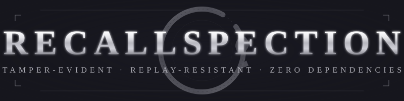

<div align="center">



<h1>ExactMemory</h1>

<p>
  <strong>A tamper-evident, replay-resistant, rollback-resistant key-value store with transparency log and remote anchor. Zero external dependencies.</strong>
</p>

<p>
  Part of the <a href="https://github.com/sciencedelicmetatech/recallspection">Recallspection</a> project · Powered by Sciencedelic Metatech.
</p>

> **Architecture:** [Synthetic Intelligence Requires Exact Memory](https://https://doi.org/10.5281/zenodo.23378369)
> **AGMI Status:** Officially certified **Level L4** (9/9 attacks rejected)  
> **Normative Spec:** [RPRS-1](https://github.com/sciencedelicmetatech/recallspection/blob/main/spec/rprs-1.tex)

[](https://agentmemoryintegrity.org/stores/recallspection-exact-anchor.html)
[]()
[]()
[]()
[]()
[]()
</div>

---

## Why ExactMemory?

AI agents, audit systems, and compliance pipelines all need one thing that most storage layers do not provide: **proof that stored data has not been modified**. 

- A plain database returns whatever bytes are on disk.
- A vector store returns the nearest neighbour, whether or not it is authentic.
- A cache silently serves stale content.

**ExactMemory** answers a different question: *"Is this record still exactly what was written?"*

Every record is sealed with a 32-byte HMAC-SHA256 tag, bound to a monotonic version counter, transparency log, and optional remote anchor. 
- If a single bit flips (payload, header, or metadata), the store refuses to return it. 
- If someone replays an older valid record, the version check rejects it. 
- If the entire container is rolled back, the transparency log rejects it. 
- If the log itself is deleted, `require_log=True` rejects it. 
- If both log and container are rolled back together, the remote anchor (e.g., S3 with Object Lock) rejects it.

The library is **pure Python standard library**. It runs on Linux, macOS, Windows, and iOS. No PyTorch. No NumPy. No native extensions.

---

## Official AGMI Level L4 Conformance

This core library powers the exact memory layer that achieved **Level L4 on the Agent Memory Integrity (AGMI) benchmark**. 

The AGMI suite tested nine storage-level edits. Recallspection (powered by `exactmemory`) rejected **9 out of 9** on the read path: 0 edits were served as genuine, and 0 were merely reported on audit.

| Attack | Verdict |
|---|---|
| T1 content tamper | rejected on read |
| T2 tail truncation | rejected on read |
| T3 middle deletion | rejected on read |
| T4 reordering | rejected on read |
| T5 forged insertion | rejected on read |
| T6 cross-context replay | rejected on read |
| T7 rollback replay | rejected on read |
| T8 metadata tamper | rejected on read |
| T9 snapshot rollback | rejected on read |

*Note: T9 requires the remote anchor backend (S3 Object Lock) to be configured.*  
[View Official L4 Conformance Result](https://agentmemoryintegrity.org/stores/recallspection-exact-anchor.html)

---

## Features

| Feature | Description |
|---------|-------------|
| **HMAC-SHA256 integrity** | **32-byte** authentication tag over full record |
| **Container MAC** | On-disk container authenticated with explicit `container_key_id` |
| **Metadata binding** | Tag covers `key_id`, `version`, `timestamp`, `nonce` - not just payload |
| **Out-of-band keys** | Keys never touch data file; `load()` accepts only caller-supplied keys |
| **Replay resistance** | Monotonic version + timestamp + optional TTL |
| **Rollback resistance** | Transparency log with hash chain - `ROLLBACK DETECTED` if file `max_version` < log tip |
| **Log deletion protection** | `require_log=True` by default - deletion triggers `LogCompromisedError` |
| **Remote anchor** | Stub interface `RemoteAnchor` + S3 example prevents log+container rollback |
| **Atomic Saves** | Prevents DB corruption on sudden crashes via `tempfile` + `os.replace` |
| **Concurrent save()** | `fcntl.flock` prevents corruption under parallel saves |
| **Substitution resistance** | Records bound to SHA3-256 digest of their key |
| **Tombstones** | Deletion writes signed tombstone with distinct status |
| **Granular Status** | `get_with_status()` returns `ok` / `missing` / `tampered` / `expired` / `tombstoned` |
| **Bit-flip property test** | Every single bit flip detected in test suite |
| **Zero dependencies** | Pure Python 3.8+ stdlib |
| **Tiny footprint** | < 600 lines core, < 20 KB installed |

---

## Installation

```bash
pip install exactmemory-recallspection